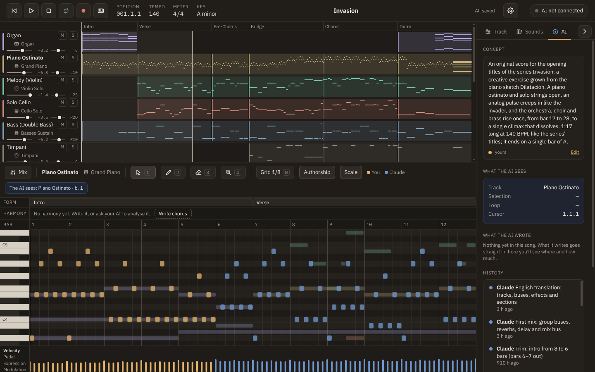

# Four Hands Studio

**Compón MIDI a cuatro manos con tu propia IA.** Tú y tu IA trabajáis sobre la misma partitura a la vez: tú tocas y editas en un piano roll, ella lee y escribe por MCP, y cada uno ve aparecer en directo las notas del otro. Cada nota dice quién la escribió.

[Read in English](README.md)



> **Estado: temprano.** Four Hands es un prototipo que funciona, construido y usado a diario en Windows por un compositor. Todavía no se ha probado en macOS ni con muchos usuarios. Encontrarás cosas por pulir; cuéntanoslas.

## Qué es

- **Una herramienta para componer, no un generador.** Dentro no hay ningún modelo musical. La IA es la que ya usas (Claude, a través de Claude Desktop), conectada por MCP. Compone contigo como lo haría un arreglista sentado a tu lado: lee la partitura, pregunta, propone, escribe y explica, y tú decides.
- **Una partitura compartida.** La IA escribe en su color, en intervenciones pequeñas que puedes escuchar con y sin ellas (tecla B) y deshacer de un paso. Nunca mueve tu vista, tu selección ni la reproducción. Cuando mueves notas que tocaste, conservan su tiempo; cuantizar es siempre decisión tuya.
- **Un piano roll que se comporta como los DAW que ya conoces**, a partir de lo que tienen en común Cubase, Logic y Studio One: arreglo, forma, armonía, cambios de tempo y de tonalidad, velocidad, pedal y curvas de expresión, y grabación desde un teclado MIDI o desde el teclado del ordenador.
- **Tus instrumentos y una mezcla de verdad.** Un motor de audio nativo aloja instrumentos y efectos VST3 (Kontakt, Vital…), con consola de mezcla, buses, envíos y ecualizador, compresor, limitador, reverb y delay propios. Mide lo que suena (sonoridad, espectro, enmascaramientos), así que la IA puede mezclar contigo midiendo, no adivinando.
- **Honesta.** La IA tiene instrucciones de dar opiniones apoyadas en la partitura, de decir lo que no funciona aunque te guste y de no elogiar su propio trabajo. Tú eliges el tono, no la honestidad.

Está pensada para quien compone despacio y con intención (cine, series, música de concierto, videojuegos), con formación o sin ella, y quiere un coautor con quien pensar, no un botón que fabrica una pista.

## Cómo funciona

```
Claude Desktop ──stdio──▶ puente de Four Hands (.mcpb) ──WebSocket local──▶ app Four Hands ──▶ motor de audio (JUCE)
```

La canción vive en la app. Tu ratón y tu teclado y las herramientas de la IA pasan por la misma capa de comandos, así que cada cambio, tuyo o de la IA, es un paso firmado que se puede deshacer. La IA tiene 45 herramientas para leer, escribir, analizar y medir, y ninguna compone: componer es cosa tuya y de tu IA. Más en [docs/architecture.md](docs/architecture.md) y [docs/mcp.md](docs/mcp.md) (en inglés).

La primera vez que abres Four Hands se abre **Invasion**, una canción de demostración con catorce pistas, buses de grupo, reverbs y un delay, escrita a cuatro manos con Claude. Su historial muestra cada intervención de Claude.

## Cómo empezar

**Requisitos:** Windows 10 u 11 (macOS está previsto, pero sin probar) y [Claude Desktop](https://claude.ai/download) para la IA. Cualquier cliente MCP que ejecute servidores locales por stdio puede usar el puente.

**Instalar:** descarga `Four-Hands-Studio-Setup-<versión>.exe` de la [última versión publicada](https://github.com/JavierBaal/four-hands-studio/releases/latest) y ejecútalo. Se instala solo para tu usuario (sin permisos de administrador) e incluye el motor de audio, los bancos de sonido y la canción de demostración. El instalador todavía no está firmado, así que Windows SmartScreen avisará: elige *Más información > Ejecutar de todas formas*.

**Desde el código:** mira [BUILDING.md](BUILDING.md) (Node 24, y Visual Studio Build Tools para el motor de audio).

**Conectar tu IA:** en la app, *Ayuda > Cómo conectar tu IA* y después *Conectar con Claude*. Claude Desktop muestra su ventana de instalación de la extensión de Four Hands; confírmala. Después pídele a Claude que componga contigo: cargará solo las skills de Four Hands.

## Documentación

La documentación técnica está en inglés:

| Documento | Qué cuenta |
|---|---|
| [docs/architecture.md](docs/architecture.md) | Cómo está construida la app y por qué |
| [docs/mcp.md](docs/mcp.md) | Qué puede ver y hacer la IA: el formato de texto musical, las herramientas, las intervenciones |
| [docs/piano-roll.md](docs/piano-roll.md) | Gestos y atajos |
| [docs/design.md](docs/design.md) | El diseño visual: tokens, tipografía, disposición, componentes |
| [docs/audio-engine.md](docs/audio-engine.md) | El motor de audio nativo |
| [skills/](skills/README.md) | El oficio que la IA carga mientras compone |
| [BUILDING.md](BUILDING.md) | Compilar la app, el puente y el motor |
| [CONTRIBUTING.md](CONTRIBUTING.md) | Cómo ayudar |

La interfaz de la app está en español y en inglés. Se aceptan contribuciones en los dos idiomas.

## Hoja de ruta

- **Lo siguiente:** automatización, exportar a WAV (mezcla y pistas sueltas) y un instalador firmado.
- **Más adelante:** macOS, escritura de keyswitches para librerías orquestales y un plugin que enlace Four Hands con tu DAW.

## Licencia

La app, el puente, el núcleo, las herramientas MCP y las skills tienen licencia [MIT](LICENSE). El motor de audio de [`engine/`](engine) tiene licencia [AGPLv3](engine/LICENSE), porque está construido sobre [JUCE](https://juce.com), que se distribuye con licencia AGPLv3 o con una licencia comercial. Los componentes y bancos de sonido de terceros están en [THIRD_PARTY_NOTICES.md](THIRD_PARTY_NOTICES.md).

Hecho por [Fran Barbero](https://github.com/JavierBaal) con Claude, a cuatro manos.
