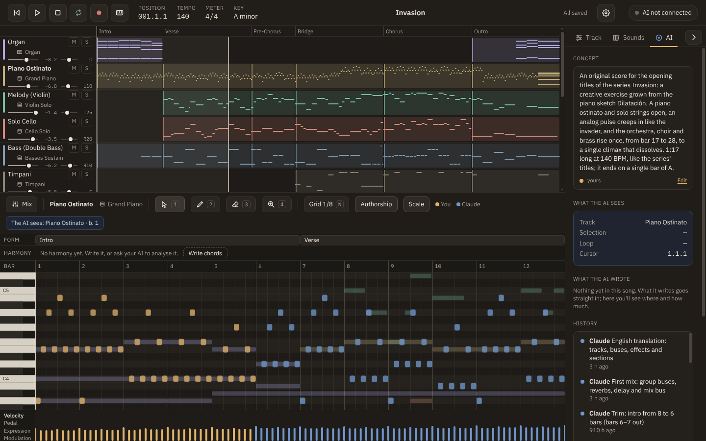

# Four Hands Studio

**Compose MIDI four-handed with your own AI.** You and your AI work on the same score at the same time: you play and edit in a piano roll, it reads and writes through MCP, and each of you sees the other's notes appear live. Every note shows who wrote it.

[Leer en español](README.es.md)



> **Status: early.** Four Hands is a working prototype, built and used daily on Windows by one composer. It has not been tested on macOS or with many users yet. Expect rough edges, and please report them.

## What it is

- **A composition tool, not a generator.** There is no music model inside. The AI is the one you already use (Claude, through Claude Desktop), connected over MCP. It composes with you the way a human arranger sitting next to you would: it reads the score, asks, proposes, writes and explains, and you decide.
- **A shared score.** The AI writes in its own colour, in small interventions you can hear with and without (key B) and undo in one step. It never moves your view, your selection or your playback. When you move notes you played, they keep their timing; quantizing is always your call.
- **A piano roll that behaves like the DAWs composers know**, based on what Cubase, Logic and Studio One have in common: arrangement, form, harmony, tempo and key changes, velocity, pedal and expression curves, recording from a MIDI keyboard or the computer keyboard.
- **Your instruments and a real mix.** A native audio engine hosts VST3 instruments and effects (Kontakt, Vital…), with a mixing console, buses, sends and Four Hands' own EQ, compressor, limiter, reverb and delay. It measures what it plays (loudness, spectrum, masking), so the AI can mix with you by measuring, not guessing.
- **Honest.** The AI is told to give opinions backed by the score, to name what does not work even if you like it, and not to praise its own work. You choose the tone, not the honesty.

It is aimed at composers who write slowly and on purpose (film, series, concert, game music), whether they have formal training or not, and want a co-author to think with rather than a button that produces a track.

## How it works

```
Claude Desktop ──stdio──▶ Four Hands bridge (.mcpb) ──local WebSocket──▶ Four Hands app ──▶ audio engine (JUCE)
```

The app holds the song. Your mouse and keyboard and the AI's tools go through the same command layer, so every change, yours or the AI's, is a signed, undoable step. The AI has 45 tools to read, write, analyze and measure, and none of them composes: composing is up to you and your AI. More in [docs/architecture.md](docs/architecture.md) and [docs/mcp.md](docs/mcp.md).

The first time you open Four Hands, it opens **Invasion**, a demo song with fourteen tracks, group buses, reverbs and a delay, written four-handed with Claude. Its history shows each of Claude's interventions.

## Getting started

**Requirements:** Windows 10 or 11 (macOS is planned but untested), and [Claude Desktop](https://claude.ai/download) for the AI. Any MCP client that runs local stdio servers can use the bridge.

**From source** (there is no packaged installer yet):

```bash
git clone https://github.com/JavierBaal/four-hands-studio.git
cd four-hands-studio
npm install        # needs Node 24 (npm 11)
npm run app
```

To play plugins and use the mixer, build the audio engine too, and put the sound banks next to the repository. Step by step: [BUILDING.md](BUILDING.md).

**Connecting your AI:** in the app, *Help > How to connect your AI*, then *Connect with Claude*. Claude Desktop shows its installation window for the Four Hands extension; confirm it. Then ask Claude to compose with you: it will load the Four Hands skills by itself.

## Documentation

| Document | What it covers |
|---|---|
| [docs/architecture.md](docs/architecture.md) | How the app is built and why |
| [docs/mcp.md](docs/mcp.md) | What the AI can see and do: the musical text format, the tools, interventions |
| [docs/piano-roll.md](docs/piano-roll.md) | Gestures and shortcuts |
| [docs/design.md](docs/design.md) | The visual design: tokens, type, layout, components |
| [docs/audio-engine.md](docs/audio-engine.md) | The native audio engine |
| [skills/](skills/README.md) | The craft the AI loads while composing |
| [BUILDING.md](BUILDING.md) | Building the app, the bridge and the engine |
| [CONTRIBUTING.md](CONTRIBUTING.md) | How to help |

## Roadmap

- **Next:** automation, export to WAV (mix and stems), a Windows installer.
- **Later:** macOS, keyswitch writing for orchestral libraries, a plugin that links Four Hands with your DAW.

## Licence

The app, the bridge, the core, the MCP tools and the skills are [MIT](LICENSE). The audio engine in [`engine/`](engine) is [AGPLv3](engine/LICENSE), because it is built on [JUCE](https://juce.com), which is available under the AGPLv3 or a commercial licence. Third-party components and sound banks are listed in [THIRD_PARTY_NOTICES.md](THIRD_PARTY_NOTICES.md).

Made by [Fran Barbero](https://github.com/JavierBaal) with Claude, four-handed.
